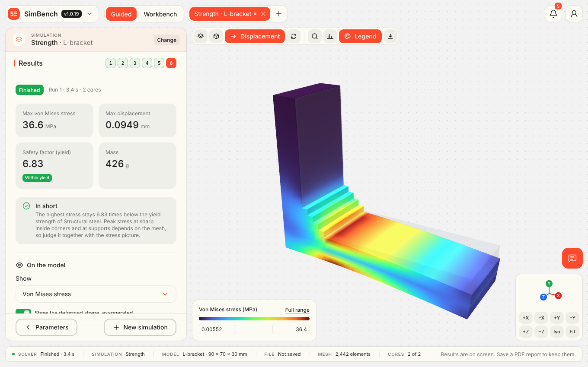

# Jerrin Varghese — SimBench (CFD + FEA simulation)

Website: **https://jerrin-v.github.io/simbench/** (sign-in required) · with the Claude features: [the app on claude.ai](https://claude.ai/artifact/GkjjxWmuB3vhF5PVrh2oq3) (a private artifact: it opens for me, signed in to Claude).

SimBench is a CFD and FEA simulation app for 3D models that runs in the browser, on the computer's own processor cores: pick a simulation, add a model, set a few parameters, review, run, and read the results on screen or save them as a PDF report.

This repo publishes SimBench as the website above, behind a sign-in page. The app runs on the computer that opens it: models and results stay there, unless you send a run to a server of your own.

## Latest updates

The last 3 updates pushed here, newest first. Kept up to date by the **Update log** workflow.

<!-- latest-updates:start -->
| Updated | Change | Version | Commit |
| --- | --- | --- | --- |
| Tue 17 Nov 2026, 11:10:24 AM UAE Tue 17 Nov 2026, 7:10:24 AM UTC | red peaks back on result surfaces (finer surface colouring); no ghost flicker; 1 px borders in Compact | v1.0.51 | [`49f8e40`](https://github.com/jerrin-v/simbench/commit/49f8e40cfec5711683e7a7ab07689bbc6354ad5d) |
| Tue 17 Nov 2026, 10:39:01 AM UAE Tue 17 Nov 2026, 6:39:01 AM UTC | cards keep their own height; thinner Compact borders; legend as wide as Job status; Recent files heading stays on top | v1.0.49 | [`435334c`](https://github.com/jerrin-v/simbench/commit/435334c7419440035b1474cc064f57011d8a5e44) |
| Tue 17 Nov 2026, 10:08:58 AM UAE Tue 17 Nov 2026, 6:08:58 AM UTC | Compact without zoom; Settings in pages; closer card text; face list reaches the corners; one status bar text size | v1.0.48 | [`981eaa2`](https://github.com/jerrin-v/simbench/commit/981eaa2165a16bd105866e4386c55a91d7d6ab72) |
<!-- latest-updates:end -->

## What it simulates

| Simulation | Question it answers | You give | You get |
|---|---|---|---|
| Strength | Will it bend or break under load? | Where it is held, and the load | Stress, deflection, safety factor |
| Vibration | At what frequencies does it vibrate? | Where it is held | Natural frequencies and mode shapes |
| Heat | How hot does it get? | Hot or cold faces, and the cooling | Temperatures and heat flow |
| Thermal stress | Does heat distort or overstress it? | Supports and temperatures | Temperature, stress and deflection |
| Airflow | How does air or water flow around it? | The fluid and its speed | Drag, lift and the flow pattern |
| Flow cooling | How well does a flow cool or heat it? | Flow speed and temperatures | Heat transfer rate and the flow pattern |

## Open it

1. **Open the website**, the address at the top, in Chrome, Edge, Firefox or Safari, and sign in with your user name and password.
2. **Give it a moment.** It needs a connection while it opens: the 3D engine and the font load from public CDNs.
3. **Follow the six steps:** Simulation → Model → Parameters → Review → Run → Results. The ready-made examples on the first screen fill everything in.

The 3D view fills the window and everything else floats over it: the name and the Guided / Workbench switch at the top left (a click on the logo opens the File menu), notifications and the account button at the top right, the settings on the left, live readouts along the bottom. The panel on the left names the simulation in hand at its head, with a **Change** button, and shows the six steps as numbered chips: a click on one goes to that step. The account button holds the user name, Settings, the tutorials, the theme and Sign out; Ask Claude is the button at the bottom right; it opens a chat panel there.

It opens in the **light theme** and in **Guided mode**. **Settings** (under the account button) changes the theme and the mode it opens in, and **Restore defaults** there brings both back.

The start screen has **Open file…** and the **recent files**, beside the six simulations; each simulation card carries its ready-made example. Once a file holds simulations, **In this file** lists them there with their state, and the one in hand is marked **Current** on its card. Recent files are the ones saved or opened last in that browser: the browser keeps its own copy of each, as it was then, so one click opens it again; the first Save afterwards asks where to put it. The cross on an entry takes it off the list.

On the website the Claude features (fill in the parameters from a description, a second opinion on the setup, what the results mean, the chat) are hidden; they work in the app on claude.ai. Everything else is the same, and files save as normal downloads. The page itself keeps nothing: closing it discards what is open, so save the simulation in a file first.

## Save a simulation in a file

1. **Click the logo** at the top left for the File menu (New, Open, Save, Save as, Server runs), then **Save as…**. On a phone the menu is under the folder button. One file, `name.sb`, takes everything: the models, every setup, the runs and their results.
2. **Open…** brings it back on any computer, as it was. A `.sb` file can also be dropped on the window.
3. **Save** writes it again under its name. `Ctrl+S` saves, `Ctrl+Shift+S` saves under a new name, `Ctrl+O` opens.

Several files can be open at once: each is a tab in the top bar, with a dot while it has changes to save. **New** opens the start screen in a new tab, **Open** opens a file in a tab of its own, and the cross on a tab closes it (it asks first if changes would be lost). A click on a tab brings that file to the front as it was left.

**Save writes into the file itself** where the browser lets a page do that: on the website in Chrome or Edge. Open `abcd.sb` (or save it once with Save as), work, press `Ctrl+S`: the file on the disk is replaced. The browser asks once whether the page may change the file. In Safari, Firefox and Brave, and inside claude.ai, a page cannot write into a file on the computer: there every save is a new download, and SimBench says so.

Inside claude.ai a page may hand over only certain kinds of file, and `.sb` is not one of them. There the file arrives as `name.sb.zip`, a ZIP that holds `name.sb`: take it out, or leave it, SimBench opens either. On the website and from your own server, SimBench saves `name.sb` itself: as a download, or in Chrome and Edge straight into the file you chose, so that **Save** writes into that same file from then on.

## Run on a server

For meshes and run times a browser tab cannot take, SimBench can send a run to a machine that runs `simbench-server.js`: the same solvers, on all of that machine's cores and memory.

1. **Get `simbench-server.js` from me** and copy it to the machine. It needs Node.js 18 or later and nothing else.
2. **Start it:** `node simbench-server.js --host 0.0.0.0`. It prints its address, its access key and its connector address.
3. **In SimBench, open Settings** (the account button at the top right, then Settings), choose **A server** and connect:
   - opened outside claude.ai: enter the address and the access key. The website is an https page, and a browser lets an https page reach https addresses only. For a server on plain http, type the server's own address into the browser instead (the server hands out the same page);
   - inside claude.ai, where a page may not open connections itself: add the connector address in claude.ai under Settings, Connectors, as a custom connector named **SimBench Compute**. The machine needs a public https address for that. On your own computer, the Claude desktop app can run the file as a local server named `simbench` instead (`node simbench-server.js --stdio`).
4. **Run as usual.** With a server chosen, mesh fineness goes up to 14 instead of 10.
5. **Close the page if you like.** A run that is on the server belongs to the server: it carries on when the page is closed or the computer is shut down. Open SimBench again and it brings the run back, with its simulation, its progress and its results. **File**, then **Server runs…**, lists every run the server holds.

The server runs one job at a time and lines up the rest. It keeps each run, with a copy of its simulation, in a folder of its own (`--data`, `.simbench-server-runs` in the home folder unless told otherwise) for a week after it ends (`--keep-hours`). A restart of the program loses nothing: ended runs are still there, and runs that were waiting or going start again. Everyone who connects with the access key sees those runs, so keep the key to yourself.

## Update it

1. **Ask Claude for the change.** Claude updates the live app on claude.ai and raises the version by 1 in the last place (v1.0.1 → v1.0.2 → …).
2. **Say "Push".** Nothing is pushed here before that.
3. The update appears here, with its version, in the **Latest updates** table above, and on the website a minute or two later.

The version is one number, kept with the app's source; the build writes it into the page: next to the app's name, on the first screen and in the PDF report.

## What's in this repo

- `backup/simbench.tar.gz.age` — the app exactly as published on claude.ai, its server program, the source, the tests and the technical notes, sealed with [age](https://age-encryption.org).
- `backup/BUILD.txt` — which version the backup holds and when it was packed.
- `keys/backup-recipient.txt` — the public key the backup is sealed with. It can't open anything.
- `tools/pack.sh` — seals a new version into `backup/`.
- `.github/workflows/publish.yml` — publishes the app as the website, behind the sign-in page, after every push to main.
- `tools/update-log.py` and `.github/workflows/update-log.yml` — keep the **Latest updates** table above up to date.
- `docs/4-results.png` — the picture above.

**If claude.ai or the website is ever gone, see [RESTORE.md](RESTORE.md)**: open the app on a computer, publish it as a website again, or rebuild the app on claude.ai.

Note: the results are for comparing designs and finding where a part is weak, not certified values. Confirm anything critical with a validated solver or a test. The 3D engine ([three.js](https://threejs.org), MIT licence) and the Inter font load from public CDNs and are not part of this repo.

---

© 2026 Jerrin Varghese. All rights reserved — see [LICENSE](LICENSE). The Alpha Design System is the property of Alpha X.
